# 신장 관리 (Kidney Management)

만성콩팥병(CKD) 개인 관리용 안드로이드 앱입니다.
검사 수치를 기록해 **신부전 위험도(KFRE)** 와 **eGFR·Creatinine·ACR 추이**를 그래프로 보고, **복약 알림**과 **진료 일정 알림**을 받습니다.
인하대병원 **My 인하** 앱의 검사결과는 버튼 한 번으로 자동으로 읽어올 수 있습니다.

> ⚠️ 개인이 만든 참고용 앱입니다. 의료기기가 아니며, 진단·치료 판단은 반드시 주치의와 상의하세요.
> 아래 화면의 수치는 모두 **예시(가짜) 데이터**입니다.

## 다운로드

**[최신 APK 받기 (Releases)](https://github.com/songhee-yeop/kidney-management/releases/latest)**

- 대상: 안드로이드 11 이상, **arm64 기기** (갤럭시 S24 FE에서 사용 중)
- 플레이스토어 앱이 아니라 APK 파일을 직접 설치합니다. 설치 방법은 [아래](#설치-방법)를 참고하세요.

---

## 주요 기능

### 홈 — 오늘 복약, 신부전 위험, 주요 수치

| 홈 | 다음 진료 |
|---|---|
| 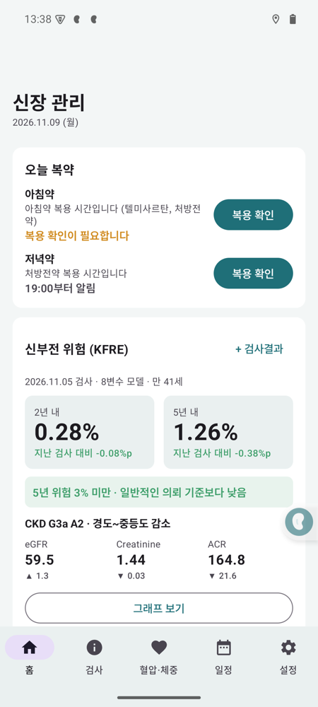 | 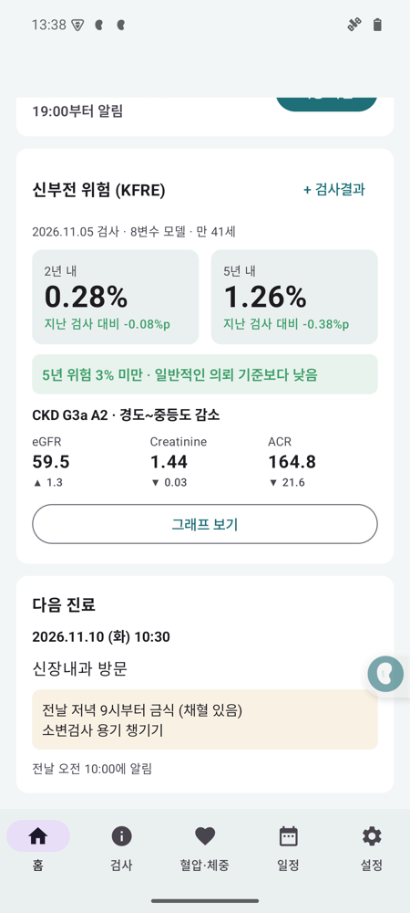 |

- 아침·저녁 복약 상태와 **복용 확인** 버튼
- 최근 검사 기준 **KFRE 2년·5년 신부전 위험**과 지난 검사 대비 변화
- CKD 병기(G·A), eGFR · Creatinine · ACR 최근값과 변화(▲▼)
- 다음 진료 일정과 메모

### 검사 — 추이 그래프

| eGFR · Creatinine | ACR · 신부전 위험 |
|---|---|
| 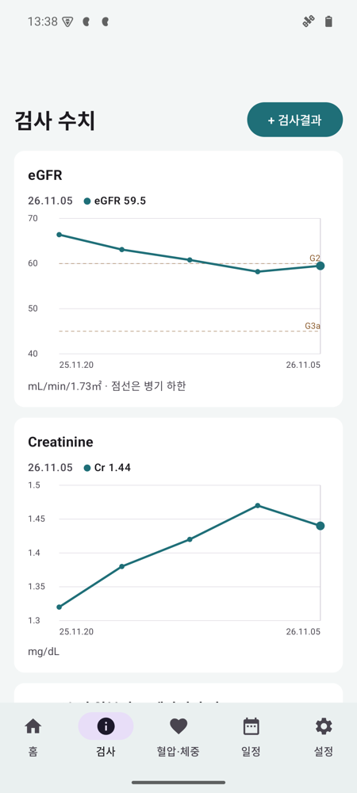 | 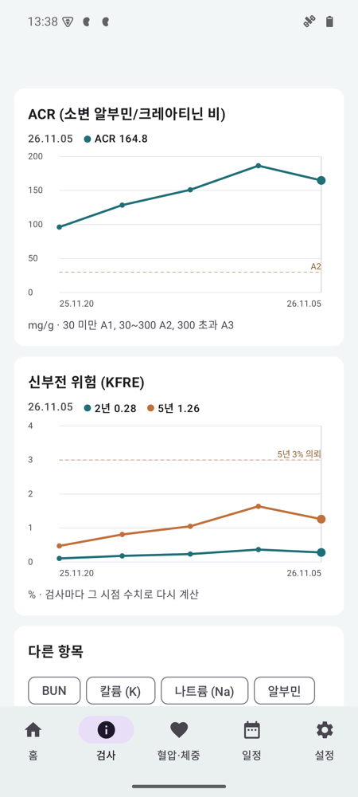 |

- **eGFR, Creatinine, ACR, KFRE(2년·5년)** 그래프는 항상 표시 (eGFR은 병기 경계, ACR은 A2/A3 경계 점선)
- 그 밖의 항목(칼륨, 나트륨, BUN, 헤모글로빈, 콜레스테롤 등)은 **다른 항목**에서 골라 그래프로 보기
- 점을 누르면 그 날짜의 값 표시

### 검사 기록 상세 · 전체 내용 복사

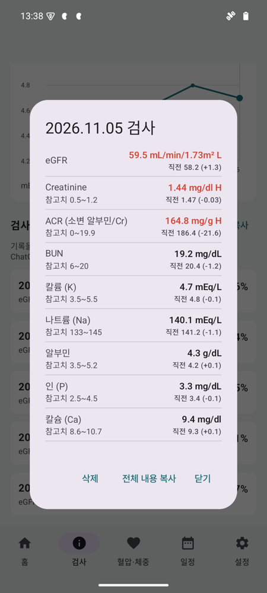

- 참고범위를 벗어난 값은 빨간색(H/L), 직전 검사 대비 변화 표시
- **저장된 수치도 눌러서 고칠 수 있습니다**
- **전체 내용 복사**: 날짜·나이·위험도·모든 수치·참고치·직전 대비 변화를 텍스트로 복사 → ChatGPT 등에 붙여넣어 물어보기
- 검사 탭의 **모든 기록 복사**로 전체 기간을 한 번에 복사

```
[검사일 2026-11-05] 41세 남성
신부전 위험(KFRE 8변수, 비북미 보정): 2년 0.28%, 5년 1.26% · CKD G3a A2
eGFR: 59.5 mL/min/1.73m² ▼낮음 [직전 2026-08-13 58.2 → +1.3]
Creatinine: 1.44 mg/dl (참고치 0.5~1.2) ▲높음 [직전 2026-08-13 1.47 → -0.03]
...
```

### My 인하 검사결과 자동 읽기

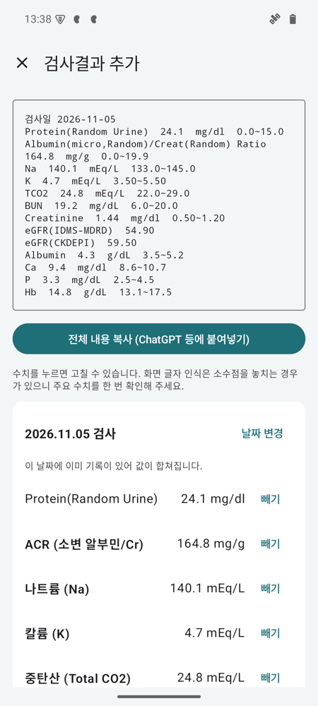

My 인하 → 검사결과조회 화면에서 **접근성 버튼(사람 모양)** 을 누르면:

1. 날짜별 분류(화학검사·소변검사·혈액검사)를 **자동으로 펼치고**
2. 끝까지 **스스로 스크롤하며** 수치를 읽은 뒤
3. 신장 관리 앱의 **미리보기**를 엽니다. 확인 후 저장하면 끝.

- **새 결과 전부** (기본): 조회된 날짜 중 **앱에 아직 없는 날짜만** 차례로 읽습니다. 처음엔 지난 기록 전체, 이후엔 새 결과만.
- **날짜 하나**: 화면 위쪽에 보이는 날짜만 읽습니다. (설정에서 선택)
- 읽는 중 버튼을 다시 누르면 멈추고, 그때까지 읽은 날짜만 보여줍니다.
- 미리보기 맨 위 **전체 내용 복사**로 읽은 결과를 바로 복사할 수 있습니다.
- 미리보기에서 **수치를 눌러 수정**하거나 항목을 **빼기** 할 수 있습니다. 같은 날짜는 기존 기록과 합쳐집니다.
- 글자 인식이 **소수점을 놓친 값은 자동 보정**하고 미리보기 맨 위에 알려줍니다 (예: Neutrophil 471 → 47.1).
  백분율 항목이 100을 넘거나, 소수점 없는 값을 10·100으로 나누면 참고치 안에 들어오는 경우가 대상입니다. (참고치가 0부터인 ACR 등은 제외)

> My 인하는 웹 화면이라 검사 항목 글자를 접근성으로 넘겨주지 않습니다. 그래서 날짜 찾기·펼치기·스크롤은 접근성으로 하고,
> **항목과 수치는 화면을 찍어 휴대폰 안에서 글자 인식(Google ML Kit 한국어 OCR)** 으로 읽습니다.
> 찍은 화면은 저장하거나 외부로 보내지 않습니다. 글자 인식이라 **소수점을 놓치는 등 오류가 있을 수 있으니** 저장 전에 eGFR·Creatinine·ACR은 꼭 확인하세요.

다른 병원 결과는 미리보기 화면에 아래 형식으로 붙여넣어도 됩니다.

```
검사일 2026-11-05
Creatinine  1.44  mg/dl  0.50~1.20
eGFR(CKDEPI)  59.50
Urine Albumin/Creatinine ratio  164.8  mg/g  0.0~19.9
```

### 복약 알림

| 상태바 알림 | 알림 설정 |
|---|---|
| 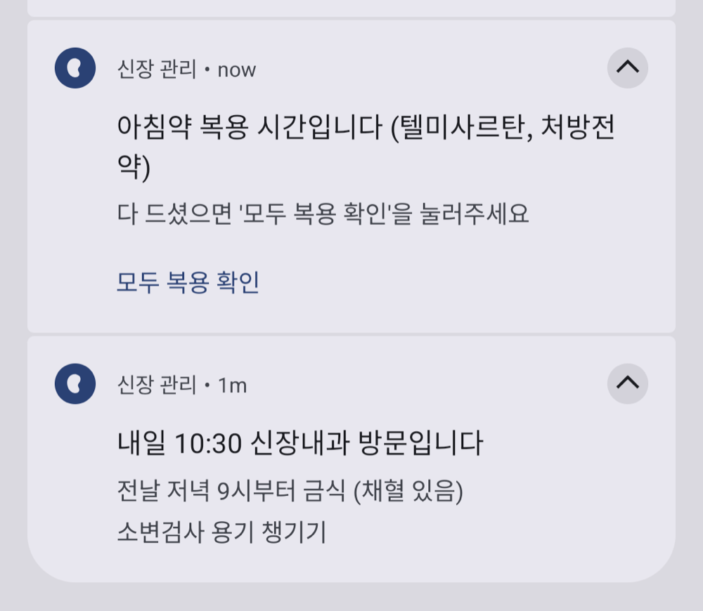 | 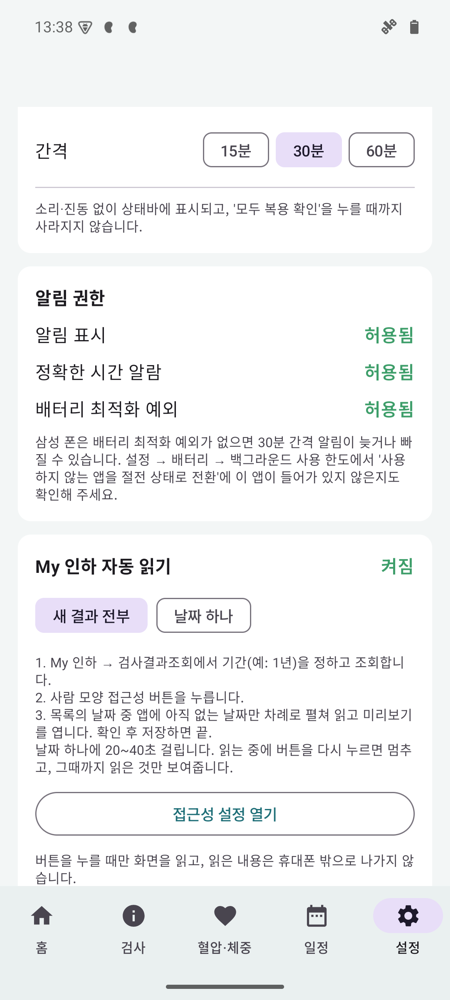 |

- 기본: **아침 07:00~10:00, 저녁 19:00~22:00, 30분 간격, 매일**
- 아침: "아침약 복용 시간입니다 (텔미사르탄, 처방전약)" / 저녁: "처방전약 복용 시간입니다" — 문구·시간·간격은 설정에서 변경
- **소리·진동 없이 상태바에만** 표시
- 알림의 **모두 복용 확인**을 눌러야 사라집니다 (밀어서 지워도 다시 뜸). 마감 시간이 지나도 확인 전이면 남아 있고, 다음 회차가 시작되면 "미복용"으로 기록

### 혈압 · 체중 / 진료 일정

| 혈압 · 체중 | 진료 일정 |
|---|---|
| 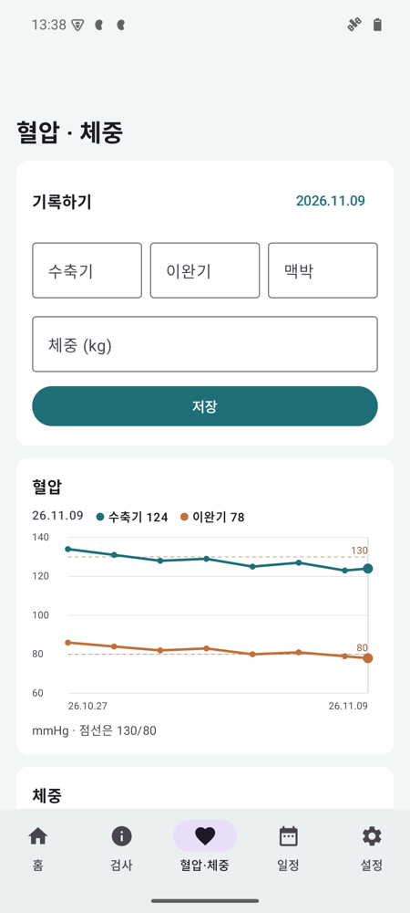 | 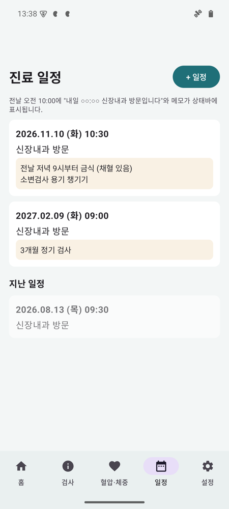 |

- 혈압(수축기·이완기·맥박)과 체중 기록, 그래프 (130/80 기준선)
- 진료 일정 + **메모**: 전날 **오전 10시**에 "내일 10:30 신장내과 방문입니다"와 메모(예: *전날 저녁 9시부터 금식*)를 상태바에 표시

### 설정 · 백업

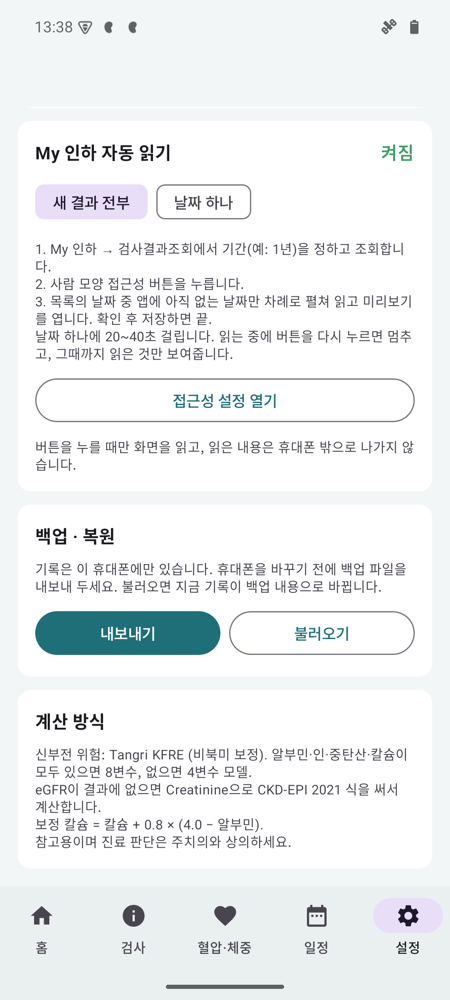

- 생년월일·성별 (처음 한 번 입력, KFRE·eGFR 계산에 사용)
- 복약 알림 문구·시간·간격, 알림 권한 상태
- My 인하 자동 읽기 방식(새 결과 전부 / 날짜 하나)
- **백업·복원**: 모든 기록은 휴대폰 안에만 저장되므로, 휴대폰을 바꾸기 전에 백업 파일을 내보내 두세요

---

## 설치 방법

1. 휴대폰에서 [Releases](https://github.com/songhee-yeop/kidney-management/releases/latest)의 `.apk` 파일을 내려받습니다.
2. **Play 프로텍트가 "기기 보호를 위해 앱 차단됨"으로 막으면**
   Play 스토어 → 오른쪽 위 프로필 → **Play 프로텍트** → ⚙ → **"Play 프로텍트로 앱 검사" 끄기** → 설치 → 설치 후 다시 켜기
   (접근성 기능이 있는 앱을 스토어 밖에서 설치하면 막히는 경우가 많습니다.)
3. "출처를 알 수 없는 앱" 허용을 물으면 APK를 연 앱(브라우저·내 파일 등)에 허용합니다.
4. 업데이트할 때는 **삭제하지 말고 덮어 설치**하세요. 삭제하면 기록이 모두 지워집니다.

## 처음 설정 (한 번만)

### 1. 알림이 제때 오도록
앱 홈 맨 위의 안내 카드 또는 **설정 → 알림 권한**에서:

| 항목 | 이유 |
|---|---|
| 알림 표시 | 복약·진료 알림 표시 |
| 정확한 시간 알람 | 30분 간격 알림을 정확한 시각에 |
| **배터리 최적화 예외** | 삼성 폰은 이게 없으면 알림이 늦거나 빠집니다 |

삼성 폰은 추가로 **설정 → 배터리 → 백그라운드 사용 한도**에서 "절전 상태 앱" 목록에 신장 관리가 **없는지** 확인하세요.

### 2. My 인하 자동 읽기 켜기 (접근성)
1. 앱 **설정 → My 인하 자동 읽기 → 접근성 설정에서 켜기**
2. **설치된 앱 → "신장 관리 · 검사결과 읽기"** → 스위치 켜기
3. **"앱의 액세스가 거부되었습니다 / 제한된 설정"** 이 뜨면:
   휴대폰 **설정 → 애플리케이션 → 신장 관리 → 오른쪽 위 ⋮ → "제한된 설정 허용"** → 다시 2번
4. 같은 화면의 **바로가기**를 켜고 **"접근성 버튼 누르기"** 선택 → 화면에 사람 모양 버튼이 생깁니다.

> 접근성 버튼은 **누를 때만** 동작합니다. 평소에 화면을 읽거나 기록하지 않습니다.

## 사용법 요약

| 하고 싶은 것 | 방법 |
|---|---|
| My 인하 결과 가져오기 | My 인하 → 검사결과조회 → 기간(예: 1년) 조회 → **사람 모양 버튼** → 미리보기 확인 → 저장 |
| 약 먹고 확인 | 상태바 알림의 **모두 복용 확인** 또는 홈의 **복용 확인** |
| ChatGPT에 물어보기 | 검사 탭 → 기록 누르기 → **전체 내용 복사** (또는 **모든 기록 복사**) |
| 혈압·체중 기록 | 혈압·체중 탭 → 입력 → 저장 |
| 진료 일정 | 일정 탭 → **+ 일정** → 날짜·시간·메모 |
| 휴대폰 바꾸기 | 설정 → 백업·복원 → **내보내기** → 새 폰에서 **불러오기** |

---

## 계산 방식

| 항목 | 방식 |
|---|---|
| 신부전 위험 | **Tangri KFRE**, 비북미(non-North American) 보정. 알부민·인·중탄산(TCO2)·보정칼슘이 모두 있으면 **8변수**, 없으면 **4변수** |
| eGFR | 결과지의 **CKD-EPI** 값 사용 (MDRD 값은 별도 항목으로만 저장). 없으면 Creatinine으로 **CKD-EPI 2021** 계산 |
| 보정 칼슘 | Ca + 0.8 × (4.0 − 알부민) |
| CKD 병기 | eGFR G1~G5, ACR A1(<30) / A2(30~300) / A3(>300) |
| 참고 기준 | 5년 3~5% 신장내과 의뢰, 2년 10% 팀 진료, 2년 20~40% 투석·이식 준비 |

KFRE 구현은 개발 중 [kidneyfailurerisk.com](https://www.kidneyfailurerisk.com/) 계산 결과와 대조해 일치를 확인했습니다.

## 개인정보

- 모든 기록은 **휴대폰 앱 내부 저장소**(`files/data.json`)에만 저장됩니다. 서버·클라우드 전송 없음.
- 안드로이드 자동 백업 대상에서 제외(`allowBackup=false`)되어 있어 **백업 파일을 직접 내보내야** 옮길 수 있습니다.
- 자동 읽기의 화면 캡처는 글자 인식에만 쓰이고 저장·전송하지 않습니다.

## 알려진 제한

- 글자 인식(OCR)이 소수점·작은 숫자를 놓칠 수 있습니다 → 미리보기에서 확인·수정
- My 인하 화면 구성이 바뀌면 자동 읽기가 동작하지 않을 수 있습니다
- APK는 arm64 기기 전용입니다 (용량을 줄이기 위해 OCR 엔진을 arm64만 포함)

---

## 개발

- Kotlin · Jetpack Compose · Material 3, minSdk 26 / targetSdk 35
- 외부 라이브러리: Google ML Kit Text Recognition (Korean) — 그 외 저장·그래프·알림은 직접 구현

```sh
export JAVA_HOME=/path/to/jdk-17
./gradlew testDebugUnitTest assembleDebug
adb install -r app/build/outputs/apk/debug/app-debug.apk
```

`local.properties`에 `sdk.dir=<Android SDK 경로>`가 필요합니다.

```
app/src/main/java/kr/songhy/kidney/
├── data/        Model.kt, Store.kt (JSON 파일 저장)
├── domain/      LabParser.kt (결과 텍스트 파싱), Kfre.kt (KFRE·CKD-EPI·항목 정보),
│                MyInha.kt (My 인하 화면 → 입력 형식), Report.kt (복사용 텍스트)
├── notify/      Scheduler.kt (복약·일정 알람), Notifier.kt, CaptureService.kt (접근성 자동 읽기 + OCR)
└── ui/          Home, Labs(검사·미리보기), Vitals, Schedule, Settings, Chart(그래프)
app/src/test/    파서·KFRE·My 인하 변환·복사 텍스트 단위 테스트 (가짜 데이터)
tools/core.js    같은 계산 로직의 초기 JavaScript 버전 (참고용)
```
